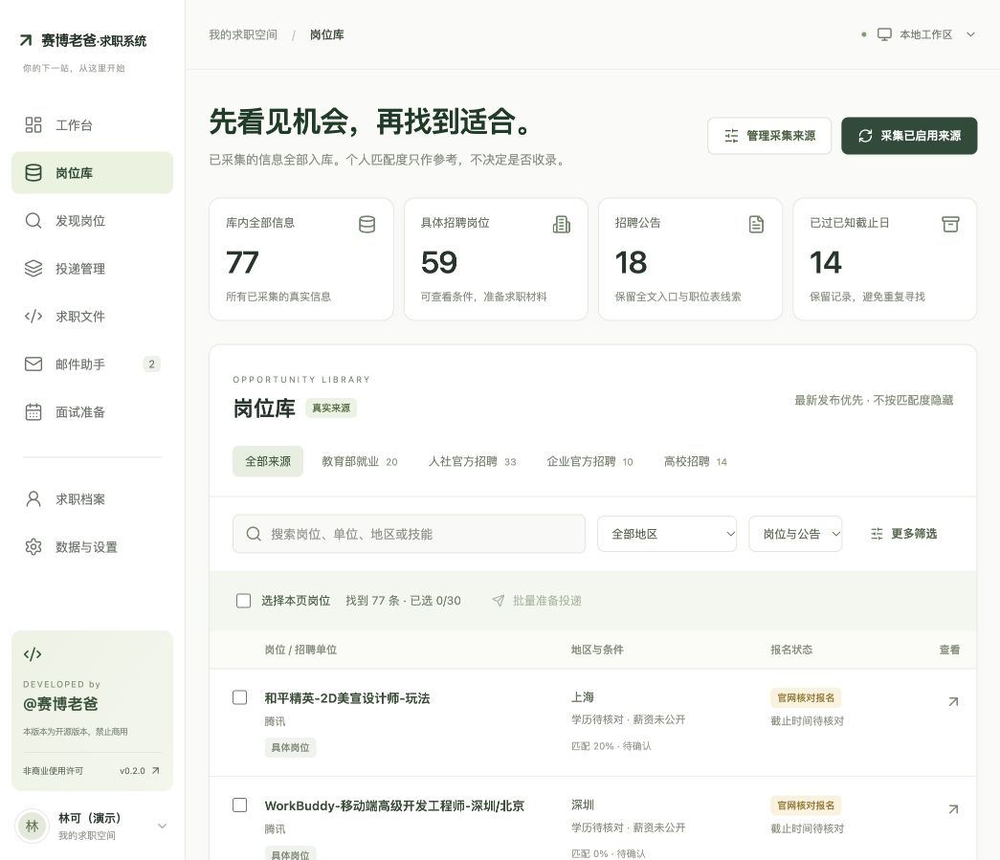
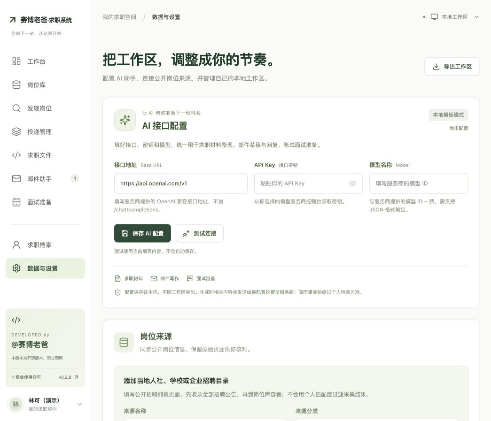

# JOB HUNTING

## 赛博老爸·求职系统

把岗位收集、条件筛选、求职文件、投递跟进和面试准备放进一个本地工作台。

**DEVELOPED by @赛博老爸，本版本为开源版本，禁止商用。**

当前版本 **v0.2.0**，技术项目名 JobPilot。采用限制商用的源码公开许可证，允许个人求职及非商业学习、研究、修改与无偿分发；**不属于 OSI 定义的开源授权**。完整条款见 [LICENSE](LICENSE)。



这是运行在自己电脑上的**单用户应用**，不需要购买服务器或域名。AI 和邮箱均为可选配置；不配置也能采集公开岗位、管理档案、查看匹配、生成文件和准备草稿。采集需要联网；关闭服务或电脑休眠后，定时任务不会继续执行。

## 当前可以做什么

| 功能 | 当前能力 |
| --- | --- |
| 真实岗位库 | 采集人社、教育部就业平台、高校和企业官网的公开信息，保留来源链接；全部已采集真实记录入库，不按个人匹配度过滤 |
| 个人匹配 | 将学历、经验等硬条件与偏好分分开展示，列出符合项、缺项及未知信息；分数不代表录用概率 |
| 求职档案 | 保存技能、偏好和简历文字；导入 TXT / Markdown，上传不超过 5 MB 的 PDF / DOCX / TXT / MD 原始附件 |
| 求职文件 | 按岗位生成简历、求职信和证据清单，分别下载可编辑 DOCX、Markdown、打印版 HTML |
| 投递管理 | 单条准备，或每批选择 1–30 个岗位生成草稿及定制简历；逐封审核后明确启动发送，记录逐项结果 |
| AI 配置 | 在设置页顶部填写 Base URL、API Key 和模型，测试连接并保存；保存后立即用于后续 AI 生成 |
| 邮件与面试 | 配置自己的 SMTP / IMAP 后收发邮件；生成回复草稿、笔试与面试准备清单 |
| 数据与来源 | 导入 JSON / CSV 岗位，导出工作数据，添加经核实的公开招聘目录；保留 Remotive / Greenhouse 补充来源 |

首次启动含清楚标注的虚构体验样例。样例不能真实发送，也不计入真实岗位库。PDF / DOCX 原始附件目前不会自动解析为档案文字；PDF 输出需下载打印版 HTML 后用浏览器打印。

## 快速开始

需要 **Node.js 22 或更新版本**及 npm。仓库也提供 pnpm 锁文件。

### Mac 双击启动

1. 下载仓库 ZIP 并完整解压，或克隆本仓库。
2. 安装好 Node.js 后，在项目文件夹中双击 **`启动求职系统.command`**。
3. GitHub 源码不包含构建产物：首次启动会安装依赖并构建，然后打开本地界面。
4. 保持终端窗口运行；结束使用时在该窗口按 `Control + C`。

原始 v0.2 源码交付 ZIP 含预构建 `dist`，启动时会复用；这与 GitHub 源码下载包不同。两者均需要 Node.js 和项目依赖。详细操作与故障排查见 [使用指南](docs/USER-GUIDE.md)。

### 终端启动

在解压后的项目目录执行：

```bash
npm install
npm run build
npm start
```

打开 [http://127.0.0.1:4318](http://127.0.0.1:4318)。服务默认只监听本机，无需域名或公网部署。首次使用无需创建 `.env`。

开发调试可执行 `npm run dev`，前端地址为 [http://localhost:5173](http://localhost:5173)，API 使用 `4318` 端口。使用 pnpm 时，安装命令为 `pnpm install --frozen-lockfile`。

## 建议的第一条求职流程

1. **求职档案**：替换体验资料，保存真实姓名、邮箱、学历、技能和简历正文，按需上传原始附件。
2. **数据与设置 → 岗位库**：启用来源并采集。所有成功取得的真实记录均入库，包括低匹配岗位、已截止记录和待核对公告。
3. **核对原文**：确认具体岗位、资格、截止日和申请方式；未展开公告与已截止记录不能直接创建投递。
4. **求职文件**：生成并检查岗位简历、求职信及证据清单，下载需要的格式。
5. **投递管理**：逐封核对收件人、全文和实际附件；每批最多 30 项，审核与发送是两个步骤。
6. **跟进与准备**：配置邮箱后同步来信，维护申请记录，按招聘方要求准备面试或笔试。

没有公开招聘邮箱时，请按官网要求申请；系统不会猜测收件人，也不会代填官网登录后的申请表。更新档案、正文或附件后，需要重新生成或核对材料并重新审核。

## 数据从哪里来

| 来源 | 本版读取范围 |
| --- | --- |
| 国家大学生就业服务平台 | 每次一页、最多 20 个公开职位及详情；平台上的用人单位并非全部为政府或事业单位 |
| 上海市人社局 | 最新 12 篇招聘公告；拆分可明确识别的正文岗位与 HTML 表格，未解析附件保留为公告 |
| 腾讯官方招聘 | 每次一页、最多 10 个职位及详情；官网更新时间与首次发布日期分开保存 |
| 复旦大学人事处 | 派遣制用工公开目录的一页公告，全部待核对；不代表全校所有招聘 |
| 自定义公开目录 | 经用户核实的地方人社、学校或企业 HTTPS 静态列表；一页最多 30 条同域公告，不抓详情、不登录 |

**2026-11-14 的交付验证共入库 77 条公开信息：59 个具体岗位、18 篇公告。** 这是四个来源在当次有限范围内的实测结果，不是固定库存、全站总量或实时有效性保证。GitHub 不包含该本地工作数据；新用户启动后需自行采集。见 [验证记录](docs/VERIFICATION.md)、[来源说明](docs/SOURCES.md) 和 [自定义来源](docs/CUSTOM-SOURCES.md)。

未提供的学历、年限、薪资、截止日和邮箱保留未知。访问失败会报告原因，不用演示数据替代。标记为“官方入口”的网站仅提供链接，不代表已接通采集；当前未接通 BOSS 直聘、智联招聘、LinkedIn 等账号内职位数据。

## AI 与邮箱：按需连接

**AI 直接在「数据与设置」顶部配置，无需修改代码或重启服务：**



1. 填写服务商提供的 **Base URL**，通常包含 `/v1`，不要填到 `/chat/completions`。远程接口使用 HTTPS；电脑上的模型服务可使用 HTTP 回环地址。
2. 填入自己的 **API Key** 和服务商实际支持、账号有权调用的**模型名称**。接口需兼容 OpenAI Chat Completions。
3. 点击 **测试连接**，使用当前表单发起一次真实模型请求；测试不会保存配置，也不会发送求职邮件，可能按服务商规则计费。
4. 保存配置，立即应用到后续求职文件排序、投递邮件草稿及重写、邮件回复草稿、笔试和面试准备。已有文件和草稿需主动重新生成。

已保存的密钥不会回显；地址不变时，密钥留空表示保留原值。更换 Base URL 时必须重新输入密钥，避免把旧密钥发到新地址。点击 **清除密钥 → 确认清除密钥** 会立即保存清除结果并停用 AI，无需再点保存，也不会重新启用 `.env` 中的旧密钥。

配置仅由本地服务保存到 `data/ai-config.json`（文件权限 `0600`），不返回已保存密钥，不写入工作区导出或日志，也不进入 Git。首次未保存界面配置时，仍兼容 `.env` 的 `AI_BASE_URL`、`AI_API_KEY`、`AI_MODEL`；一旦保存，本地配置优先。

**邮箱仍在 `.env` 配置，修改后需要重启。** 首次将根目录 `.env.example` 复制为 `.env`，只填写所需项目；已有文件时直接编辑，避免覆盖。

| 配置 | 作用 |
| --- | --- |
| `AI_BASE_URL`、`AI_API_KEY`、`AI_MODEL` | 未保存本地 AI 配置时的兼容回退；修改环境变量后需要重启 |
| `SMTP_HOST`、`SMTP_PORT`、`SMTP_USER`、`SMTP_PASS`、`SMTP_FROM` | 使用自己的邮箱发信 |
| `IMAP_HOST`、`IMAP_PORT`、`IMAP_USER`、`IMAP_PASS` | 同步自己的收件箱 |
| `ENABLE_OUTBOUND=false` | 默认禁止所有真实发信；只有显式改为 `true` 才可发送 |
| `PORT`、`DATA_DIR` | 可选本地端口与数据目录，默认 `4318` 和项目下 `data` |

AI 未配置或调用失败时使用注明方式的本地规则与模板。匹配始终由本地规则计算；求职文件中的 AI 只排列已有技能和核对事项，不能补写履历。邮件草稿、回复和准备清单可由模型生成，使用前需审阅。启用远程模型后，相关上下文会发送至你配置的服务；API 用量与费用以服务商规则为准。

自动化默认关闭。自动投递只处理人工审核后的队列，并额外要求精确邮箱白名单；自动回复仅发送固定收件确认。批量与自动发送共享每日额度，取消任务不能撤回已经提交 SMTP 的邮件。

**原 v0.2 交付验证未配置真实邮箱或模型凭据，未向任何招聘方发送邮件。** 邮箱测试使用受控替身，真实账号的连接与收发需在本地配置后验证。AI 配置已保存不代表测试成功；连接测试只验证当次请求。邮箱显示“已启用”也不等于服务商已验证登录成功。

## 本地数据与开发

个人档案、岗位、材料、投递和邮件保存在 `data/state.json`，原始附件位于 `data/attachments/`，界面保存的 AI 配置位于 `data/ai-config.json`。这些是本机明文资料。完整备份前先停止服务，再复制整个 `data` 目录；该备份会包含 AI 密钥，需私下妥善保管。界面导出 JSON 不含附件二进制或 AI 密钥。

`.env`、`data/`、`node_modules/` 和 `dist/` 不进入 Git 版本控制。填写个人资料后，不要把本地工作区重新打包公开；发布前仍需检查待上传内容。

```text
src/        React 界面与页面
server/     本地 API、来源、匹配、文件、邮件与批次
tests/      规则、存储与适配器测试
docs/       使用指南、架构、接口、来源与验证说明
public/     界面静态资源
scripts/    本地启动工具
```

开发检查：`npm test`、`npm run build`。已有 v0.2 验证记录包含 90 项自动测试、真实 DOCX 检查及桌面/手机界面检查；具体范围以 [验证记录](docs/VERIFICATION.md) 为准。

- [中文使用指南](docs/USER-GUIDE.md)：从首次启动到备份与故障排查
- [架构说明](docs/ARCHITECTURE.md) · [API 合约](docs/API-CONTRACT.md) · [求职文件](docs/DOCUMENTS.md)
- [贡献指南](CONTRIBUTING.md) · [参考逻辑说明](docs/REFERENCE-NOTES.md) · [图像记录](docs/IMAGE-PROMPTS.md)

## 许可

本项目采用 **Source-available NonCommercial License v1.0**。个人申请有报酬的工作属于允许的个人求职用途；销售、收费托管或部署、招聘机构商业使用、整合进商业产品等用途受禁止。分发须保留 **@赛博老爸** 署名和许可证。第三方依赖仍遵循各自许可证。完整条款见 [LICENSE](LICENSE)。
