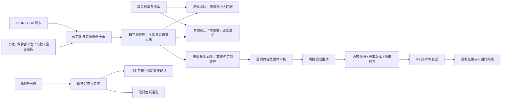

# 赛博老爸·求职系统 v0.2 架构

技术项目名 JobPilot。本项目运行在用户电脑上，供单用户使用。React / Vite 提供界面，Node.js / Express 提供 `/api` 和构建静态文件，本机 JSON 保存状态。后端默认只监听 `127.0.0.1:4318`，开发前端位于 `127.0.0.1:5173`。

## 招聘信息先入库，匹配单独计算

来源同步与人工导入不以匹配度、学历或经验是否符合为收录条件。`jobs` 保存全部成功取得并去重的记录；岗位库默认显示真实岗位、未展开招聘公告和已过已知截止日的记录，排除 `isDemo` 虚构样例。匹配结果附在 bootstrap 响应中，供个人筛选使用，不决定入库。

岗位库与「发现岗位」是独立页面。库中可按来源类别、来源、地区、学历、薪资、信息类型和已知截止状态过滤。没有截止日仅表示待核对，不能等同于长期有效。公告和已截止记录可继续查看原始资料，但不作为可直接准备/发送的具体申请。

## 模块边界

| 模块 | 职责 |
| --- | --- |
| `src/App.jsx`、`src/store.jsx` | 应用外壳、导航、工作区数据和 API 状态 |
| `src/pages/Library.jsx` | 不受匹配过滤的真实岗位库、来源采集、逐项查看与批量选择 |
| `src/pages/` | 个人发现、投递管理、求职文件、邮件、准备助手、档案和设置 |
| `server/store.js` | 串行状态更新、原子写入、版本迁移与中断批次恢复标记 |
| `server/seed.js` | 清楚标记的虚构体验数据；不冒充真实同步记录 |
| `server/source-catalog.js` | 来源身份、官方入口、类别、可同步状态和最低同步间隔 |
| `server/china-sources.js` | NCSS、上海人社、腾讯公开接口/HTML 的有界读取及专用解析 |
| `server/page-source.js` | 高校及地方官方公开页面适配、页面范围与网络访问约束 |
| `server/connectors.js` | 来源路由、Remotive / Greenhouse 公开接口 |
| `server/matching.js` | 可解释的本地硬条件和偏好评分 |
| `server/documents.js` | 事实型求职材料、受约束 AI 排序与 DOCX/MD/HTML 输出 |
| `server/resume.js` | 原始简历大小与格式验证、私有附件保存与读取 |
| `server/batches.js` | 最多 30 项准备、逐项审核、内容指纹、串行批次和取消 |
| `server/safety.js` | 输入验证、来源身份去重、发送条件和档案审核失效 |
| `server/ai.js` | 邮件/准备内容的模型接口与本地模板回退 |
| `server/service.js` | 材料、申请、来源、任务互斥、发送预留与自动化调度 |
| `server/mail.js` | SMTP、IMAP、辅助分类及循环回复抑制 |
| `server/app.js`、`server/index.js` | HTTP 路由、本机访问约束、静态页面与定时任务 |

具体字段与路由见 [API 合约](API-CONTRACT.md)。来源实施边界见 [SOURCES.md](SOURCES.md) 和 [CUSTOM-SOURCES.md](CUSTOM-SOURCES.md)，文件格式与事实约束见 [DOCUMENTS.md](DOCUMENTS.md)。

## 来源身份与数据保真

主状态包括 `profile`、`profileRevision`、`jobs`、`materials`、`applications`、`batches`、`messages`、`sources`、`settings`、`logs` 和发送流水。来源记录保存 `sourceId`、`externalId`、原始 URL、`recordType`、发布日期、原站更新时间、截止日、报名方式与待核对标记。

官方岗位按来源与外部 ID 识别，允许同一公告 URL 展开多个职位。上海岗位表展开合并单元格，并使用部门区分同名岗位；无法明确展开的附件或页面保留为 `recordType: announcement`，不将整篇多人招聘公告伪装成单一职位。腾讯长 `PostId` 按字符串保存；`LastUpdateTime` 使用 `sourceUpdatedAt`，不冒充 `publishedAt`。

学历、年限、工资等未明确提供时保留空值。截止日只提取报名语境中的日期，不采用同句后续的笔试、面试或居住证计算日。咨询、监督、举报邮箱，以及明确不接收邮件简历的页面，不自动填作投递收件人。唯一公开邮箱仍需人工核对其用途。

JSON / CSV 一次最多导入 500 条，本地岗位上限 5000 条。普通导入使用规范化后的岗位身份去重；来源内身份用于避免重复同步并保持同公告多岗位的独立性。库中保留截止信息和历史记录，不以个人是否匹配而删除。

## 中国官方来源与自定义页面

内置来源覆盖三类目标：人社与公共就业（上海人社、NCSS）、学校招聘（复旦大学人事处派遣制用工公开目录）、企业自有招聘（腾讯）。来源目录中未实现连接器或访问受限的网站明确标记为仅入口，不计作可同步来源。

NCSS 每次读取 1 页最多 20 个职位及详情；上海读取最新 12 篇公告；腾讯每次读取 1 页最多 10 个职位及详情。固定连接器使用固定官方域名，详情并发最多 2、单个读取操作超时 18 秒、响应最多 2 MiB，按来源最低间隔同步。先检查 robots；机器人规则拒绝、网络失败或详情结构不兼容时报告失败，不回退到演示数据。岗位请求不跟随重定向；robots 可跟随一次同域跳转，拒绝跨域与多次跳转。

复旦固定页面与自定义地方人社/学校页面使用 `public-page` 目录连接器，每次只读取一页，最多保留 30 条同域链接，不请求详情。全部保守标记为待核对公告，仅确定的标题、链接和发布时间入库；邮箱、学历、工资等保持未知。自定义页面仅允许标准 443 端口的 HTTPS，检查 DNS 返回的全部地址，并将 HTTPS 连接固定到已验证公网地址。固定复旦来源只有代码定义的 ID、类型和完整 URL 三者一致时走正常本机网络路径，以兼容代理；该例外不能由用户配置获得。不承诺动态网页、登录后职位、附件表格或全站历史数据的完整解析。配置与域名/页面访问限制以 [CUSTOM-SOURCES.md](CUSTOM-SOURCES.md) 为准；新增来源只增加采集范围，不改变全部入库的原则。

Remotive / Greenhouse 仍作为补充来源：Remotive 至少间隔 6 小时，注明原站 24 小时延迟；Greenhouse 使用配置 board 的公开 GET，不调用雇主授权申请 POST。

## 档案、匹配与求职文件

`profileRevision` 在档案保存、原始附件更新或删除时提高。旧审核因此失效，未发送队列退回草稿。申请和求职材料保留生成时版本及演示来源；替换真实档案不会自动清除旧草稿的演示标记，须按当前真实档案重新生成。

偏好分满分 100：技能覆盖 40、地点 20、行业 15、岗位名称 10、薪资交集 15。未明确的信息不计分；学历与最低经验是独立硬条件，高分不能抵消不符合。技能采用去空白与大小写归一后的精确匹配；未知币种不换算。分数只帮助整理机会，不表示录用概率，也不影响岗位库收录。

原始简历支持 PDF、DOCX、UTF-8 TXT/MD，最大 5 MB，保存到 `data/attachments/` 的随机命名私有文件。模型不直接解析原附件，简历正文另行维护。

按岗位生成的材料包含简历、求职信、证据清单，支持真正的 DOCX、Markdown 和打印版 HTML。没有原生 PDF 导出；用户可通过浏览器打印 HTML 为 PDF。简历简介与经历沿用档案，技能只能来自已有技能；不将岗位要求当成个人能力。材料中的求职信与证据清单按事实模板构建，AI 仅可返回已有技能/核对项的索引顺序，校验不通过则回退本地排序。邮件草稿生成属于独立能力，需在发信前审阅。

下载 DOCX 或作为附件发送时生成文件，不把 DOCX Base64 塞入状态。材料绑定岗位与档案版本。投递已选定材料时优先附该岗位定制简历 DOCX；未绑定时用上传的原始简历，再无则回退 `resume.txt`。文件生成与档案事实边界详见 [DOCUMENTS.md](DOCUMENTS.md)。

## 批次、审核与发送

`POST /api/batches/prepare` 接受 1–30 个岗位 ID，逐项创建草稿及定制材料。某项失败返回具体原因，其他项继续；准备不发送邮件。公告和已截止岗位由服务层拒绝建立具体申请。

批量审核提交每项更新时间、内容指纹和当前 `profileRevision`。指纹包含申请 ID、收件人、主题、正文、材料 ID、档案版本及审核状态。审核必须逐项确认接收地址、内容和附件；服务端检查内容未被替换、材料属于同一岗位及当前档案版本，然后加入队列。

开始发送需再次明确确认当前已审核内容。批次保存每项指纹并串行执行；每次发送预留在状态串行事务内重新核对：当前任务状态、取消标记、内容指纹、档案审核版本、岗位截止、附件版本、真实发送配置与额度。内容变化则跳过，不继续使用过期审核。

批量发送与自动投递/自动回复共享按 Asia/Shanghai 日期统计的每日额度。手动明确启动的批次不要求自动投递开关或自动白名单；无人值守的自动投递/回复额外要求对应开关和精确邮箱白名单。所有真实发送均要求有效 SMTP、`ENABLE_OUTBOUND=true`、真实档案和非演示内容。

取消会阻止后续尚未开始的发送，不能撤回已提交 SMTP 的在途邮件。服务启动时，遗留的 queued/running 批次改为 interrupted，未完成项记录跳过原因，不自动重试。`pending` 或 `uncertain` 的发送记录需要先核对发件邮箱，避免重复投递。

发送成功状态仅在 SMTP 明确接受后落盘，不代表招聘方已阅读。服务器未给出可确认结果时记录 uncertain 并锁定。所有批次可查询每项 sent、failed、skipped 或 cancelled 结果及原因，批次历史保留最近 100 个。

## 邮件、AI 与本机运行

SMTP / IMAP 凭据只由后端环境读取。IMAP 读取最近 30 天最多 100 封、单封最多 1 MiB，单次总量最多 8 MiB；邮件正文作为文本保存，附件不执行、不持久保存。分类为关键词辅助判断，不能代替招聘方明确通知。

邮件求职信、回复草稿和准备清单可通过兼容 Chat Completions 的接口生成；输出验证失败、超时或未配置时返回注明模式的本地模板。求职文件只用 AI 进行受约束排序。远程来源和邮件是待核对参考数据，模型不拥有发信或执行工具。自动回复使用固定收件确认，不替用户承诺面试时间或接受录用。

调度器每分钟检查已启用任务，自动同步默认间隔 60 分钟，同时遵守各来源最低间隔。停止程序、休眠或关机后不继续；没有云端托管调度。默认每日自动与批量共享额度为 5 次。

## 持久化、交付与验证

`data/state.json` 为受限文件权限的本机明文数据。状态更新在内存副本上完成，先写临时文件再原子替换；写入失败不提交新内存状态，损坏文件不静默重置。进程内串行队列不是跨进程锁，请勿多进程写同一目录。

完整备份需停止服务后复制整个 `data` 目录及原始附件；JSON 导出不含附件二进制、内部文件路径或 `.env` 凭据，仍含简历、邮件和其他个人资料。v0.2 源码交付包排除 `data/`、`.env`、研究缓存与 `node_modules/`，启动时本地安装依赖。

2026-11-14，NCSS、上海人社、腾讯三个连接器真实读取并通过岗位规范化的记录共 63 条；该数字只描述这三源当次验证，不作为新增高校源后的总库存。解析测试使用带原始 URL 的精简官方响应固定样本；批次、DOCX 与发送测试使用可控替身，不向招聘方投递。本轮未使用真实 SMTP / IMAP 凭据收发邮件，也未以真实模型服务验证生成质量。最终自动测试数量与界面验收范围见 [VERIFICATION.md](VERIFICATION.md)。

增加来源优先实现专用适配器；增加发送能力需保留内容审核、额度、取消、幂等与审计约束。多人版本需另建身份隔离、数据库和跨进程任务管理。本项目许可为 **Source-available NonCommercial License v1.0**，开发者 **@赛博老爸**；当前为限制商用的源码公开版本，禁止商用，不属于 OSI 定义的开源许可证。
